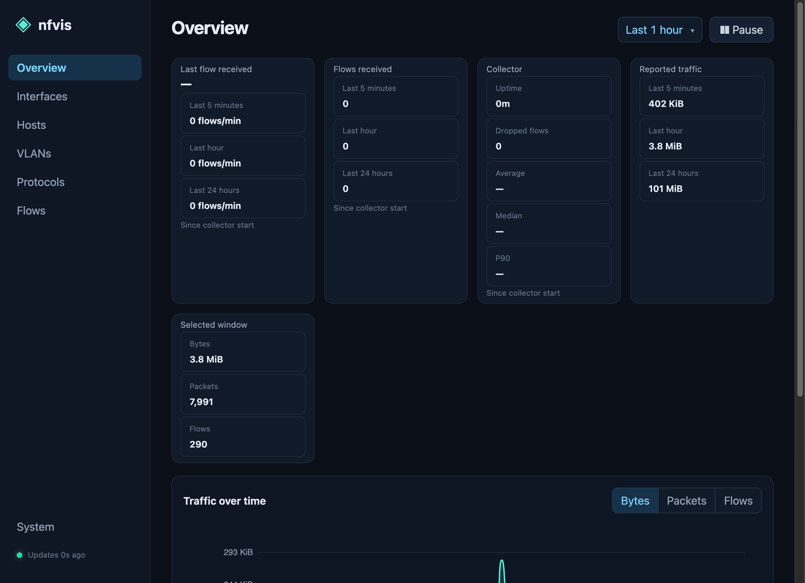
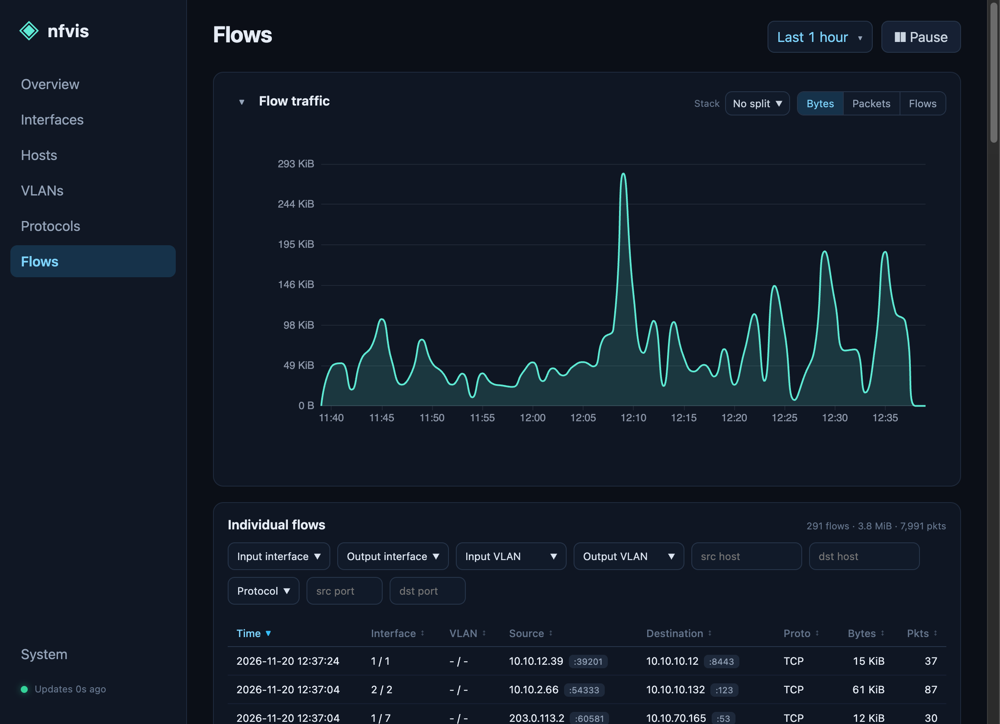

# nfvis — Homelab NetFlow Collector and Dashboard

nfvis is a single-process Go service that receives NetFlow v5 and v9 over UDP, stores normalized flows and hourly aggregates in SQLite (WAL), and serves a React/ECharts dashboard embedded in the binary.

It is designed for a homelab: one binary, one database file, no external services.

## Quick start

With Nix installed, the flake provides Go, Node/npm, Make and SQLite tooling:

```bash
nix develop          # or: make dev
make build           # dashboard + Go binary
./nfvis --config config.example.yaml
```

`make help` lists all targets (`test`, `test-race`, `vet`, `check`, `bench`, `soak`, `seed-db`, `run`, `clean`). The Makefile wraps commands with `nix develop --command`, so it also works from outside the shell. Set `GO`/`NPM` to use local tools instead.

Without Nix:

```bash
# Build the dashboard once (output goes to internal/webui/dist, which is embedded)
cd web && npm install && npm run build && cd ..

# Build and run
go build -o nfvis ./cmd/nfvis
./nfvis --config config.example.yaml
```

Open <http://127.0.0.1:8080>. Send NetFlow to UDP `0.0.0.0:2055`.

To install the binary from the module instead of building a checkout:

```bash
go install github.com/a-bali/nfvis/cmd/nfvis@latest
```

The embedded dashboard is committed, so a module install needs no Node toolchain. Release tags are `vMAJOR.MINOR.PATCH`, matching `go install ...@vX.Y.Z`.

If the dashboard assets are missing, the binary still builds but serves a placeholder page. Always run `npm run build` before the final `go build`.

## Sample data

`make seed` (also available as `make seed-db`) fills a scratch database with two months of synthetic traffic shaped like an existing database, so the dashboard can be explored before the collector has history:

```bash
make seed                                     # 60 days into data/seed.db
./nfvis --config config-seed.yaml              # dashboard on http://127.0.0.1:8081
```

The seeder samples exporters, interfaces, protocols, hosts, destination ports and the daily volume curve from `data/nfvis.db` (override with `SEED_PATTERN=other.db`, or omit it to use built-in defaults), then writes flows through the normal store path. Recent hours keep individual flows, older days only aggregates, and every chart-resolution tier is filled - the same mixed-resolution state a collector reaches after a few weeks. Volume scales with `SEED_FLOWS_PER_HOUR` (the busiest hour of the day; the default 1500 leaves about 250k flows in the 30-day raw window and a ~200 MB database) and `SEED_DAYS` sets the span:

```bash
make seed-db SEED_DAYS=120 SEED_FLOWS_PER_HOUR=20000 SEED_DB=data/big.db
```

The generated `config-seed.yaml` listens on `127.0.0.1:2056` / `127.0.0.1:8081` and disables DNS lookups, so it can run next to the real instance. Override its path with `SEED_CONFIG`; `make seed-clean` removes the configured seed database and config.

## Dashboard guide

The screenshots below use synthetic traffic generated with the seeder's built-in pattern; they do not contain production data.

On the Flows page, an unstacked chart with only one Source host or Destination host filter can use hourly totals for history that predates raw flow retention. Enter an exact IP, or use `ip:192.168.1.` for an address-only substring. Bare substring searches also match stored hostnames and still use raw flows. The individual flow table, stacked charts with filters, and compound filters still require raw flows.

### Overview and time navigation

The Overview chart defaults to a configured interface labeled `wan` (or a numbered WAN label), if available. Choose a configured interface to plot ingress above zero and egress below zero. The same interface is matched against input for ingress and output for egress; the legend calls these Download and Upload for WAN. These are rates from stored flow records, not interface hardware counters. The interface chart uses one resolution across the selected window: 1-minute rollups for up to six hours, 5-minute rollups for longer ranges, or hourly totals if finer history does not cover the window. Interface rollups are retained for 7 days at 1 minute and 30 days at 5 minutes. The upgrade backfills only retained flows; older hourly totals are not expanded into finer points. It shows only complete buckets, so partial buckets at the edges of a range are omitted. Choose **All reported traffic** for the original collector-wide chart.



The Overview combines collector receipt and processing statistics, recent reported traffic, and totals for the selected window. Receipt and processing counters are **since this collector started**, so a seeded database can show historical traffic even when those counters are zero. Select a rolling preset or enter custom From/To bounds in the global time picker. Drag horizontally over a chart to select a custom window. Pause the automatic refresh when inspecting a snapshot; URL-encoded view, range and filter state can be shared or revisited with browser navigation.

### Explore rankings and flows



- **Interfaces, Hosts, VLANs and Protocols** rank traffic by bytes, packets and flows. Choose ingress/egress or source/destination where applicable, sort and paginate, and select a row to drill into matching individual flows. Hosts supports case-insensitive IP substring and reverse-DNS name search.
- **Flows** shows a traffic chart and individual records. Filter by source/destination host, input/output interface or VLAN, protocol and source/destination port; the filters also apply to the chart. Select a row for endpoint, timing, exporter and sampling details. Sortable columns are ordered across the result set, not just the current page.
- **Charts** support bytes, packets or flows. On the Flows page, stack by interface, VLAN, host or protocol and toggle bands through the legend; up to ten named bands are shown plus an “Other” band. Collapse the Flows chart when focusing on the table.
- **System** shows retention, DNS cache, ingest health, counters and database information, and can clear the DNS cache.

Older windows may contain hourly aggregates after individual flows expire. Chart resolution depends on retained tiers, and filtered charts use retained raw flows. The UI reports coverage and query limitations; see [UI notices and warnings](docs/ui-notices.md).

## Defaults

| Setting | Default |
| --- | --- |
| UDP listen | `0.0.0.0:2055` |
| HTTP listen | `127.0.0.1:8080` |
| SQLite | `data/nfvis.db`, WAL, `synchronous=NORMAL` |
| Raw flow retention | 30 days |
| Hourly aggregate retention | 1 year |
| Retention sweep | startup, then every hour |
| Chart resolution tiers | 1 minute for 7 days, 5 minutes for 30 days |
| Batch size / flush | 1000 flows / 250 ms |
| Decode workers / queue | 4 / 4096 packets |
| Template TTL | 30 minutes |
| Auth / TLS | none (HTTP bound to loopback) |
| DNS resolver | system resolver; set `dns.server` to pin one |

## Features

- NetFlow v5 and v9 decoding with per-exporter, per-source-ID template isolation, refresh, expiry and reboot detection.
- Normalized flows: exporter/interface identity, L3/L4 endpoints, TCP flags, VLAN provenance, sampling metadata and timestamp provenance.
- Hourly aggregates for exporter, interface, host, VLAN and protocol, with source/destination and ingress/egress kept as separate views.
- Bounded, paginated JSON API with half-open UTC ranges and mixed raw/aggregate coverage that never double-counts.
- Dashboard with 5-second polling (pausable from the header), a time-range filter, ranked drill-down, a Hosts DNS-name/IP filter, a Flows page with input/output interface-label, input/output VLAN, source/destination host (IP substring or reverse-DNS name), protocol, and source/destination port filters, and explicit unknown/aggregate-only states. Reverse DNS is resolved asynchronously for new flows and captured historically; cache results are reused for a configurable TTL (default 5m). Lookups may be missed under load or on shutdown, and pre-existing flows have no captured name. The IP stays available in each row's tooltip; see [Operations](docs/operations.md) for diagnostics and limitations. Both traffic charts use the global time range and plot average bytes, packets or flows per second for each time bucket as a filled area (chosen with a Bytes/Packets/Flows toggle in the panel header); these are bucket averages, not instantaneous rates. Totals in tables and cards remain totals. Both charts use the global range; the Flows chart applies its own filters and can be collapsed with a chevron, its filters also apply to the chart, and a `Stack` dropdown splits it into stacked bands by input/output interface, input/output VLAN, source/destination host or protocol, with a legend table showing the top ten bands plus an `Other` fold. Unfiltered stacked charts read whole hours from the hourly aggregates and only scan individual flows for the most recent six hours, so they stay fast even over 30 days; filtered stacked charts scan raw flows and are bounded by the query budget. Dragging horizontally in either chart zooms the dashboard to that window and sets the selector to `Custom`; a spinner covers the chart while a changed window or filter loads. Charts draw minute buckets for recent hours, five-minute buckets out to a month and hourly buckets beyond, mixing tiers in one series when a range spans them; filtered charts read raw flows only. Ranked views always include all exporters. View and filter state is encoded in the URL, so back/forward navigation and shared links work.
- Retention sweeps in bounded batches; raw flows and aggregates expire independently.

## Containers and releases

See [release and container instructions](docs/releases.md) for GHCR development and versioned images, configuration, and publishing.

## Documentation

- [Architecture and data model](docs/architecture.md)
- [Operations](docs/operations.md)
- [UI notices and warnings](docs/ui-notices.md)
- [Security](docs/security.md)
- [Benchmarks and capacity](docs/benchmarks.md)

## Verification

```bash
go test ./...
go test ./internal/decoder -run '^$' -bench . -benchmem
DURATION=60s TARGET=1000 ./benchmark/soak.sh
cd web && npm run check && npm run build
```

## MVP limitations

- NetFlow v10/IPFIX, sFlow and IPFIX options are not supported.
- HTTP has no built-in authentication or TLS. Keep the default loopback bind or put an authenticated TLS reverse proxy in front.
- UDP is unauthenticated and spoofable; restrict who can reach the collector port.
- Sampled traffic is stored as received (not multiplied up). Sampling rate and source are recorded per flow.
- Individual flow detail is unavailable after raw retention expires; hourly aggregates remain queryable.
- A single SQLite writer means nfvis is intentionally a single-process service.
